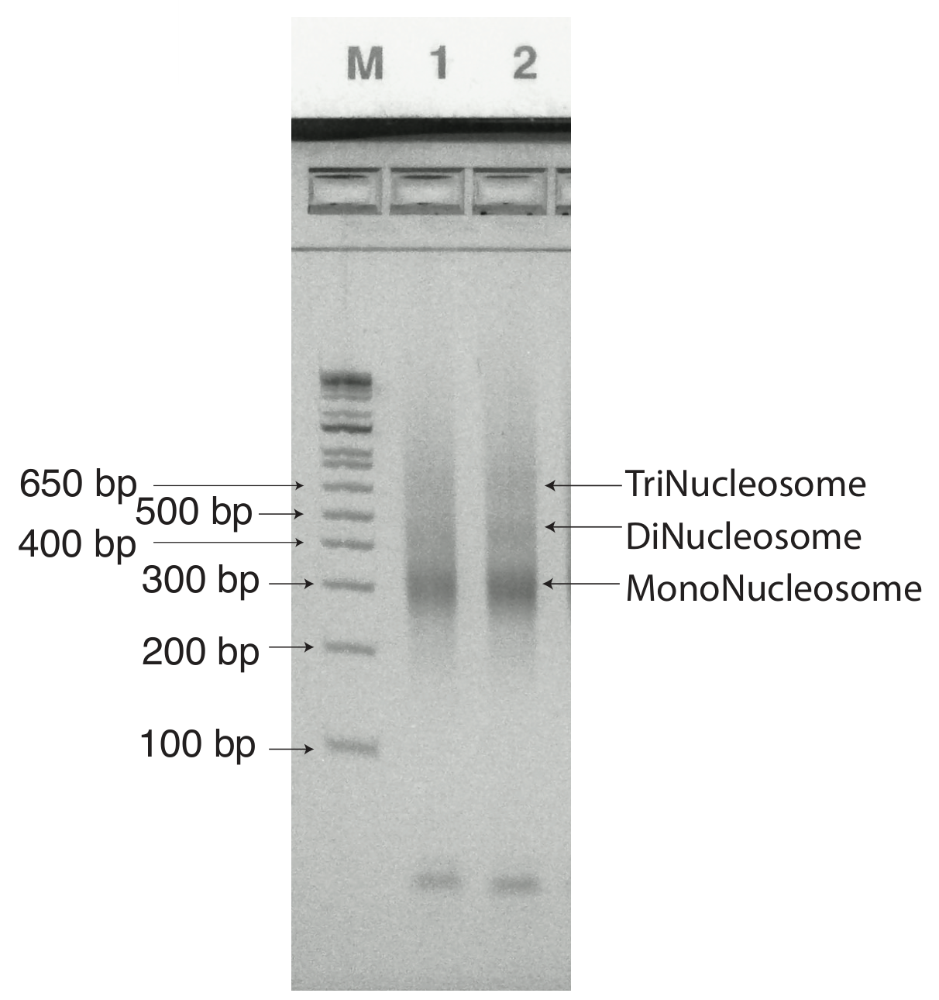

# CUT&Tag Test on Tissue Sections

The first bench check for a new tissue or antibody. Tissue sections on ordinary glass slides go
through the antibody and tagmentation steps of SPACE-Tag Day 1, but the PA-Tn5 carries standard
Nextera adapters instead of the SPACE-Tag T7 adapters. The tagmented DNA is released with
proteinase K, amplified by PCR and run on a gel. It answers one question cheaply: does this
antibody direct tagmentation in this tissue?

**Tags:** CUT&Tag | Tissue | Antibody validation | PA-Tn5 | Pilot

**Back to:** [SPACE-Tag protocols home](start.html) · **Next step:** [IVT test](ivt-test.html)

---

## When to run it

- A new tissue type.
- A new antibody or antibody lot.
- A new PA-Tn5 batch.

Run it after the antibody has been checked by immunofluorescence and before the
[IVT test](ivt-test.html). It does not test the SPACE-Tag-specific steps (tissue clearing, gap
filling, IVT), which is what the IVT test is for.

## Design

16-well gasket (ArrayIT AHC1X16 or Grace Biolabs ProPlate 244864) on a standard glass slide,
10 µm sections, one section per well.

| Well | Purpose | Expected result |
|---|---|---|
| Antibody of interest, in duplicate | Targeted tagmentation | PCR product clearly above the no-antibody well |
| No primary antibody | Untargeted PA-Tn5 background | Little or no product |
| No PA-Tn5 (optional) | Contaminating DNA and primer artefacts | No product |
| Positive-control antibody (optional), e.g. a well-characterized H3K27me3 or H3K4me3 antibody | Shows the tissue and PA-Tn5 work | Strong product |

## Transposome with standard Nextera adapters

Load PA-Tn5 exactly as in Day 0 and Step 0 of the [SPACE-Tag protocol](index.html), replacing the
two SPACE-Tag adapters with the standard Tn5 mosaic-end adapters (Picelli et al. 2014). Anneal each
of Tn5ME-A and Tn5ME-B with Tn5MErev.

| Oligo | Sequence (5′→3′) |
|---|---|
| Tn5ME-A | `TCGTCGGCAGCGTCAGATGTGTATAAGAGACAG` |
| Tn5ME-B | `GTCTCGTGGGCTCGGAGATGTGTATAAGAGACAG` |
| Tn5MErev | `/5Phos/CTGTCTCTTATACACATCT` |

## Day 1: antibodies and tagmentation

Follow the [SPACE-Tag protocol](index.html), **Steps 1 to 5** (fixation, permeabilization,
primary antibody, secondary antibody, PA-Tn5 binding and tagmentation), using the Nextera-loaded
PA-Tn5. Stop after tagmentation: skip tissue clearing, gap filling and IVT.

## Release the DNA with proteinase K

1. Remove the tagmentation buffer.
2. Per well, prepare **9 µl proteinase K (NEB P8107S) + 61 µl Buffer PKD (Qiagen 1034963)** and add
   the 70 µl onto the tissue.
3. Seal the wells and incubate **1 h at 50 °C**.
4. Transfer the digest of each well to a labelled 1.5 ml tube.

## Purify the DNA

Purify each digest with the Zymo ChIP DNA Clean & Concentrator (D5201), or with 2× AMPure XP
beads. Elute in **50 µl**.

## PCR

**Gap filling.** Mix the 50 µl eluate with **50 µl OneTaq 2× Master Mix (NEB M0482)** and
incubate **5 min at 68 °C** in a thermal cycler. Tn5 leaves a 9 nt gap at each insertion; this step
fills it so that the fragments can be amplified, and it must come before any denaturation.

**Amplification.** To the same tube, add:

| Component | Volume (µl) |
|---|---:|
| Gap-filled reaction (from above) | 100 |
| i5 primer (S50x), 10 µM | 7.5 |
| i7 primer (N70x), 10 µM | 7.5 |
| OneTaq 2× Master Mix | 25 |
| Nuclease-free water | 10 |
| **Total** | **150** |

Each primer ends at 0.5 µM and the master mix at 1×. Cycle as in the OneTaq 2× Master Mix protocol
(NEB M0482), with a 55 °C anneal and a 1 min extension:

| Step | Temperature | Time | Cycles |
|---|---|---|---|
| Initial denaturation | 94 °C | 30 s | 1 |
| Denaturation | 94 °C | 30 s | 12 |
| Annealing | 55 °C | 30 s | 12 |
| Extension | 68 °C | 1 min | 12 |
| Final extension | 68 °C | 5 min | 1 |
| Hold | 4 °C | | |

The best cycle number depends on the tissue and the antibody. Adjust it if the product is faint or
the gel shows over-amplification.

Primers (5′→3′; `[i5]` and `[i7]` are 8 nt index sequences):

| Primer | Sequence |
|---|---|
| i5 (S50x) | `AATGATACGGCGACCACCGAGATCTACAC[i5]TCGTCGGCAGCGTC` |
| i7 (N70x) | `CAAGCAGAAGACGGCATACGAGAT[i7]GTCTCGTGGGCTCGG` |

**Clean-up.** Double-sided AMPure XP size selection. Add 0.45× beads and keep the supernatant,
which removes large fragments. Add beads to the supernatant up to 1×, keep the beads, wash and
elute.

## Readout

Run the library on a 2% agarose gel next to a 100 bp ladder, or on a TapeStation (High
Sensitivity D5000 ScreenTape).

- Antibody wells show clearly more product than the no-antibody well.
- The no-PA-Tn5 well is empty apart from primer dimer.
- Duplicates look alike.

*Example gel (2% agarose). Two conventional H3K27ac CUT&Tag libraries from tissue sections,
tagmented under the conditions used for SPACE-Tag. The libraries show mono-, di- and
tri-nucleosomal fragments; the PCR primers add 99 bp to each fragment, so the mononucleosome band
runs near 300 bp. The bands at the bottom are primer dimer, which the double-sided clean-up removes.
M, E-Gel 1 Kb Plus DNA Ladder.*

If the antibody wells look no better than the no-antibody well, change the antibody or its
dilution before moving on to the [IVT test](ivt-test.html). Libraries that pass can also be
sequenced shallowly to check enrichment at known loci.

## References

- New England Biolabs. Protocol for OneTaq 2X Master Mix with Standard Buffer (M0482).
- Kaya-Okur H.S. et al. CUT&Tag for efficient epigenomic profiling of small samples and single
  cells. Nat. Commun. 10, 1930 (2019).
  [doi:10.1038/s41467-019-09982-5](https://doi.org/10.1038/s41467-019-09982-5)
- Picelli S. et al. Tn5 transposase and tagmentation procedures for massively scaled sequencing
  projects. Genome Res. 24, 2033–2040 (2014).
  [doi:10.1101/gr.177881.114](https://doi.org/10.1101/gr.177881.114)
