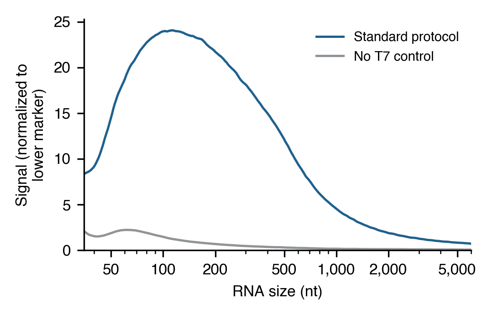

# SPACE-Tag IVT Test on Plain Slides

A low-cost check that the Day 1 chemistry works on your tissue, antibody and reagent lots before
you commit a Visium slide. Tissue sections on ordinary glass slides go through Day 1 of the
[SPACE-Tag protocol](index.html) or the
[SPACE-Tag-HD protocol](https://chaoyan115.github.io/SPACE-Tag-HD-protocol/) exactly as written.
The IVT RNA is then released, purified and run on an RNA TapeStation, which reports both its
amount and its size distribution. Qubit and RT-qPCR are optional additional readouts.

**Tags:** SPACE-Tag | IVT | RNA purification | TapeStation | Pilot

**Back to:** [SPACE-Tag protocols home](start.html) · **Previous step:** [CUT&Tag test](cuttag-test.html)

---

## When to run it

- A new tissue type.
- A new antibody, a new antibody lot, or a new PA-Tn5 batch.
- A change to any Day 1 buffer, enzyme or incubation.

Run the test before the spatial experiment. It reports how much IVT RNA the reaction made and how
long it is. It does not report spatial capture or library complexity, so a good result is
necessary but not sufficient for a good library.

## Design

Use a 16-well gasket (ArrayIT AHC1X16 or Grace Biolabs ProPlate 244864) on a standard glass slide,
10 µm sections, one section per well. Include these wells on every slide:

| Well | Purpose | Expected result |
|---|---|---|
| Reference condition, in duplicate | The current standard protocol. The difference between the two duplicates is the noise floor of the run | Similar yield and size profile in both |
| Test conditions, 2–3 wells each | The change being tested | Compared with the reference |
| No T7 (IVT solution with water in place of T7) | Background: endogenous RNA that survives the protocol | Much lower yield than any +T7 well |
| No primary antibody | Non-specific tagmentation | Clearly lower yield than the reference |

Compare conditions only within one slide, and run all samples of a slide on the same TapeStation
run (and, if used, the same qPCR plate).

## Day 1

Follow Day 1 of the [SPACE-Tag protocol](index.html) or the
[SPACE-Tag-HD protocol](https://chaoyan115.github.io/SPACE-Tag-HD-protocol/), Steps 0 to 8 (PA-Tn5
loading, fixation, permeabilization, antibodies, tagmentation, tissue clearing, gap filling, IVT),
on the plain slide.

---

## Readout overview

| Step | What happens | Key condition |
|---|---|---|
| 1. Release | Proteinase K (NEB P8107S) in Buffer PKD frees IVT RNA from the tissue | 50 °C for 1 h (tested on mouse brain and colorectal cancer) |
| 2. Purify | Zymo RNA Clean & Concentrator-5 with on-column DNase I | Room temperature, 15 min DNase; elute 10 µl |
| 3. TapeStation | High Sensitivity RNA ScreenTape on 2 µl of eluate | **Main readout:** amount and size distribution of the IVT RNA |
| 4. Analysis | Compare with the reference and the no-T7 well | Result of the test |
| Optional | Qubit RNA HS on 2 µl | Quick total-RNA check |
| Optional | Oligo-dT RT and SYBR Green qPCR | More sensitive yield comparison |

**Eluate budget (10 µl per well):** TapeStation 2 µl, optional Qubit 2 µl, optional RT 2 µl (+RT
and no-RT, 1 µl each), the rest kept for a repeat.

## Reagents and equipment

| Item | Supplier, cat. no. | Note |
|---|---|---|
| Proteinase K, Molecular Biology Grade | NEB P8107S | Step 1 |
| Buffer PKD | Qiagen 1034963 | Step 1 |
| RNA Clean & Concentrator-5 with DNase I set | Zymo Research R1013 | Add 96 ml 100% ethanol to the 24 ml RNA Wash Buffer concentrate. Reconstitute DNase I (250 U) in 275 µl water and store frozen aliquots |
| Ethanol, 95–100% | | For binding |
| High Sensitivity RNA ScreenTape, Sample Buffer, Ladder | Agilent 5067-5579, 5067-5580, 5067-5581 | |
| TapeStation, heat block, microcentrifuge | | |

Reagents for the optional Qubit and RT-qPCR readouts are listed in those sections.

---

## Step 1. Release IVT RNA with proteinase K

1. At the end of the IVT, take the slide off the heat block. Remove and discard the IVT solution
   from each well.
2. Per well, prepare **9 µl proteinase K (NEB P8107S) + 61 µl Buffer PKD (Qiagen 1034963)** and add
   the 70 µl onto the tissue.
3. Seal the wells and incubate **1 h at 50 °C**.
4. Transfer the whole digest of each well to a labelled RNase-free 1.5 ml tube. Record the
   recovered volume, because the binding volumes in Step 2 scale with it.

## Step 2. Purify RNA (Zymo RCC-5, on-column DNase)

Use the default total-RNA protocol, which recovers RNA of 17 nt and longer. Do not use the
size-fractionation option: it discards short transcripts, and transcription on fixed chromatin
yields many short ones (Handa et al., Nat. Protoc. 2020). All steps at room temperature.
Centrifuge at 10,000–16,000 × g for 30 s unless stated.

| Recovered sample (µl) | RNA Binding Buffer, 2 vol (µl) | Ethanol, equal to sample + buffer (µl) | Load (µl) |
|---:|---:|---:|---:|
| 70 | 140 | 210 | 420 |
| 100 | 200 | 300 | 600 |

1. Add 2 volumes of RNA Binding Buffer to the sample and mix.
2. Add ethanol equal to the combined volume and mix.
3. Transfer to a Zymo-Spin IC column. Centrifuge and discard the flow-through. The column holds
   700 µl per load and can be reloaded.
4. Add 400 µl RNA Wash Buffer. Centrifuge and discard the flow-through.
5. DNase: per sample, mix 5 µl DNase I (1 U/µl) with 35 µl DNA Digestion Buffer by gentle
   inversion. Add the 40 µl directly onto the column matrix. Incubate 15 min at room temperature.
6. Add 400 µl RNA Prep Buffer. Centrifuge and discard the flow-through.
7. Add 700 µl RNA Wash Buffer. Centrifuge and discard the flow-through.
8. Add 400 µl RNA Wash Buffer. Centrifuge 1 min to remove all wash buffer. Move the column to an
   RNase-free tube.
9. Add 10 µl nuclease-free water directly to the matrix and centrifuge. Keep the eluate on ice.

> Use the same elution volume for every well, because yield is compared as concentration. If the
> release buffer contains SDS, keep it at or below 0.1% in the sample, the stated tolerance of the
> Zymo column (Zymo R1013 manual).

## Step 3. TapeStation (High Sensitivity RNA ScreenTape)

1. Bring the Sample Buffer to room temperature. Thaw the ladder and samples on ice.
2. Ladder: 1 µl Sample Buffer + 2 µl ladder. Samples: 1 µl Sample Buffer + 2 µl eluate. On the
   4200 TapeStation, first dilute the ladder vial with 10 µl RNase-free water, as in the Agilent
   quick guide.
3. Mix, spin down, heat **72 °C for 3 min**, cool on ice for 2 min, spin 1 min.
4. Run on the TapeStation. If a sample exceeds the tape's range, dilute it, rerun, and note the
   dilution.

## Step 4. Analysis and acceptance

- **Overlay the traces** of the reference, the test conditions and the no-T7 well, each normalized
  to the lower marker. IVT RNA is the signal above the no-T7 trace. Compare how much of it there is
  and where it sits, not only the instrument's total concentration.
- **Amount.** Integrate each trace over a fixed size window and subtract the no-T7 trace, because
  endogenous RNA that survives the protocol also contributes signal.
- The no-T7 and no-antibody wells are clearly lower than the reference. If they are not,
  background dominates and the run cannot be read.
- A difference smaller than the gap between the two reference duplicates is not a difference.
- With 2–3 wells per condition, report individual values rather than P values.

*Example traces (mouse brain, 10 µm sections). With the standard protocol, IVT RNA forms a broad
smear peaking near 100–200 nt and extending past 1,000 nt. The no-T7 control, run in parallel with
identical steps except T7 polymerase, stays near baseline across the whole range.*

---

## Optional: Qubit RNA HS

A quick total-RNA number. Qubit measures all RNA, including endogenous RNA that survives the
protocol, so subtract the no-T7 well and use it only as a cross-check of the TapeStation result.
Reagents: Qubit RNA HS Assay Kit (Thermo Fisher Q32852) and Qubit assay tubes (Thermo Fisher
Q32856).

1. Bring reagent, buffer and standards to room temperature.
2. Prepare working solution: Qubit RNA HS Reagent diluted 1:200 in RNA HS Buffer, 200 µl per tube.
   For 12 samples, 2 standards and 1 spare: 15 µl reagent + 2,985 µl buffer.
3. Standards: 190 µl working solution + 10 µl standard. Samples: 198 µl working solution + 2 µl
   eluate.
4. Vortex 3–5 s and incubate 2 min at room temperature. The signal is stable for 3 h.
5. Read standards, then samples, with sample volume set to 2 µl.

## Optional: RT-qPCR

A more sensitive comparison of IVT yield between conditions. It measures amount only, not size.

**Additional reagents**

| Item | Supplier, cat. no. | Note |
|---|---|---|
| Maxima H Minus Reverse Transcriptase, with 5× RT buffer | Thermo Fisher EP0751 | |
| Oligo-dT RT primer, 10 µM | IDT | Sequence below |
| dNTPs, 10 mM each | NEB N0447S | |
| RNaseOUT, 40 U/µl | Thermo Fisher 10777019 | Also a 4 U/µl working dilution for Mix 1 |
| Betaine, 5 M; MgCl₂, 100 mM | | RT Mix 2 |
| KAPA SYBR FAST qPCR Master Mix (2×) | Roche | Use the ROX setting your instrument requires |
| qPCR primers, 10 µM each | IDT | Sequences below |
| qPCR instrument, thermal cycler | | |

Oligo-dT RT primer, 5′→3′ (spaces for reading only: Read 1 handle, fixed 16 nt, N12, T30):

`CTACACGACGCTCTTCCGATCT GATCGACGTACGATCC NNNNNNNNNNNN TTTTTTTTTTTTTTTTTTTTTTTTTTTTTT`

### Reverse transcription (oligo-dT)

The IVT RNA carries a poly(A) tail from the poly(T) adapter, so oligo-dT primes it directly. The RT
runs identically on every sample, so its efficiency cancels in ΔCq. Set up one +RT reaction per
well and one no-RT reaction per condition (enzyme replaced with water). Do not normalise RT input
to the Qubit value: every well contributes the same volume, because the difference in amount is the
result.

**Mix 1: anneal (7 µl per reaction)**

| Component | 1× (µl) |
|---|---:|
| Purified IVT RNA | 1.0 |
| Oligo-dT primer, 10 µM | 1.0 |
| dNTPs, 10 mM each | 1.0 |
| Maxima 5× RT buffer | 2.0 |
| RNase inhibitor, 4 U/µl | 1.0 |
| Nuclease-free water | 1.0 |
| **Total** | **7.0** |

1. Make a master mix without RNA, dispense 6 µl per tube, add 1 µl RNA, mix and spin.
2. Incubate 72 °C for 3 min, then 4 °C.

**Mix 2: extension (4 µl per reaction)**

| Component | 1× (µl) |
|---|---:|
| Nuclease-free water | 1.0 |
| Betaine, 5 M | 1.85 |
| MgCl₂, 100 mM | 0.8 |
| RNase inhibitor, 40 U/µl | 0.25 |
| Maxima H Minus RT (water for no-RT) | 0.1 |
| **Total** | **4.0** |

1. Add 4 µl of Mix 2 to each annealed tube (11 µl final). Mix gently and spin.
2. Run 42 °C 90 min, 50 °C 2 min, 42 °C 2 min, 70 °C 15 min, hold at 4 °C.
3. Do not purify. Dilute every RT reaction in nuclease-free water by the same factor, between 1:10
   and 1:100, so that Cq falls near 15–20. Each 10-fold dilution adds about 3.3 cycles.

### qPCR

The primers sit at the two ends of the cDNA: one in the Read 1 handle of the RT primer, one in the
Tn5 adapter handle, which endogenous mRNA lacks. The product therefore spans the whole insert and
has a range of lengths rather than one size. Put all samples and controls on one plate, because Cq
is not comparable across plates.

| Primer | Sequence (5′→3′) |
|---|---|
| Forward: PF-nexteraR2-DME | `GTCTCGTGGGCTCGGAGATGTGTATAAGAGACAG` |
| Reverse: cDNA-oligo1 | `CTACACGACGCTCTTCCGATCT` |

| Component | 1× (µl) | Final |
|---|---:|---|
| 2× KAPA SYBR FAST master mix | 10.0 | 1× |
| Forward primer, 10 µM | 0.4 | 200 nM |
| Reverse primer, 10 µM | 0.4 | 200 nM |
| PCR-grade water | 7.2 | |
| Diluted RT | 2.0 | ≤10% of reaction |
| **Total** | **20.0** | |

1. Dispense 18 µl master mix per well, then 2 µl template. Seal and spin.
2. Cycle: 95 °C 3 min; 40 × (95 °C 1–3 s, 60 °C ≥20 s with plate read); melt curve.
3. Run technical triplicates, and the no-template control in triplicate. Place every sample's
   replicates in matching plate positions, so an edge or row effect hits all samples equally.

### qPCR analysis

- Mean Cq of the triplicate per sample. ΔCq = Cq(sample) − Cq(reference). Fold change in IVT RNA
  = 2^(−ΔCq). ΔCq 1 = 2×; ΔCq 3.3 = 10×.
- Because the product spans inserts of different lengths, the melt curve of +RT wells is one broad
  peak. A separate sharp low-temperature peak is primer dimer. The no-template control is flat.
- No-RT and no-T7 wells sit many cycles later than the matching +RT wells.
- The direction of change agrees with the TapeStation result.

## References

- Zymo Research. RNA Clean & Concentrator-5 Instruction Manual (R1013).
- Thermo Fisher Scientific. Qubit RNA HS Assay Kit User Guide (MAN0002327).
- Agilent Technologies. High Sensitivity RNA ScreenTape System Quick Guide.
- Roche. KAPA SYBR FAST qPCR Kit Technical Data Sheet (KR0389).
- Handa T. et al. Chromatin integration labeling for mapping DNA-binding proteins and
  modifications with low input. Nat. Protoc. 15, 3334–3360 (2020).
  [doi:10.1038/s41596-020-0375-8](https://doi.org/10.1038/s41596-020-0375-8)
